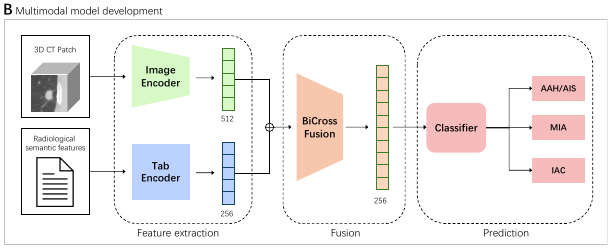

{::nomarkdown}
<!doctype html>
<html lang="en">
<head>
  <meta charset="utf-8">
  <meta name="viewport" content="width=device-width, initial-scale=1">
  <title>Hongtao Zhang | Computer Vision and Medical Imaging</title>
  <meta name="description" content="Hongtao Zhang is a postdoctoral researcher at the Shenzhen Institutes of Advanced Technology, Chinese Academy of Sciences. Biography, publications, and education.">
  <link rel="canonical" href="https://vison-eden.github.io/Hongtao-eden/">
  <link rel="icon" href="assets/img/zht.png">
  <link rel="stylesheet" href="assets/css/research-profile.css">
  
  
  
  
  
  
</head>
<body id="top">
<a class="skip" href="#main-content">Skip to content</a>

  <header class="mast">
    <a href="#top">Hongtao Zhang</a>
    <nav aria-label="Main navigation"><a href="#publications">Publications</a><a href="#education">Education</a></nav>
  </header>
    <main id="main-content">
    <section class="intro" aria-labelledby="name">
      

        
HZ

        

          <h1 id="name">Hongtao Zhang</h1>
          
Postdoctoral Researcher

          
Shenzhen Institutes of Advanced Technology, Chinese Academy of Sciences

        

      

      
I earned my master’s and doctoral degrees in Intelligent Informatics at Kochi University of Technology in Japan, where I worked with <a href="https://www.kochi-tech.ac.jp/profile/en/yoshida-shinichi.html">Professor Shinichi Yoshida</a>. My doctoral studies were supported by the university’s Special Scholarship Program. Before moving to Japan, I studied network engineering at Jilin University of Zhuhai College under the supervision of <a href="https://ieeexplore.ieee.org/author/37401143200">Professor Yanchun Liang</a>.

      
My research interests include visual cognition, computer vision, and medical imaging. I am particularly interested in what comparisons between human vision and neural networks can tell us about how we perceive images.

      

        <a href="assets/files/cv.pdf">CV (PDF)</a>
        <a href="https://scholar.google.com/citations?user=jQvs2JIAAAAJ">Google Scholar</a>
        <a href="https://github.com/Vison-eden">GitHub</a>
        <a href="mailto:edenzht@gmail.com">Email</a>
      

    </section>
    <section class="group" id="publications" aria-labelledby="pub-title">
      <h2 id="pub-title">Publications</h2>
      <ul class="pubs">
        <li class="paper-with-thumb">
          2026
          

            <a href="https://doi.org/10.1038/s41746-026-03062-x">Multimodal deep learning for preoperative invasiveness stratification of lung adenocarcinoma spectrum nodules</a>
            Hongtao Zhang et al. · npj Digital Medicine · <a href="https://github.com/Vison-eden/ct-mm">Code</a>
          

          
        </li>
        <li>2024
<a href="https://doi.org/10.1109/ACCESS.2024.3475478">Assessing brain-like characteristics of DNNs with spatiotemporal features: a study based on the Müller-Lyer illusion</a>Hongtao Zhang, Kiminori Matsuzaki, Shinichi Yoshida · IEEE Access
</li>
        <li>2024
<a href="https://doi.org/10.3390/app14083429">Exploring deep neural networks in simulating human vision through five optical illusions</a>Hongtao Zhang, Shinichi Yoshida · Applied Sciences
</li>
        <li>2024
<a href="https://doi.org/10.1371/journal.pone.0299083">Brain-like illusion produced by Skye’s Oblique Grating in deep neural networks</a>Hongtao Zhang, Shinichi Yoshida, Zhen Li · PLOS ONE
</li>
        <li>2021
<a href="https://doi.org/10.3390/s21092978">3D MRI reconstruction based on 2D generative adversarial network super-resolution</a>Hongtao Zhang, Yuki Shinomiya, Shinichi Yoshida · Sensors
</li>
      </ul>
    </section>
    <section class="group" id="education" aria-labelledby="edu-title">
      <h2 id="edu-title">Education</h2>
      <ul class="degrees">
        <li>2024
Ph.D. in Intelligent InformaticsKochi University of Technology, Japan · Special Scholarship Program
</li>
        <li>2021
M.E. in Intelligent InformaticsKochi University of Technology, Japan
</li>
        <li>2019
B.E. in Network EngineeringJilin University of Zhuhai College, China
</li>
      </ul>
    </section>
  </main>
  <footer><a href="mailto:edenzht@gmail.com">edenzht@gmail.com</a> · <a href="https://www.researchgate.net/profile/Hongtao-Zhang-33">ResearchGate</a></footer>

</body>
</html>
{:/nomarkdown}
